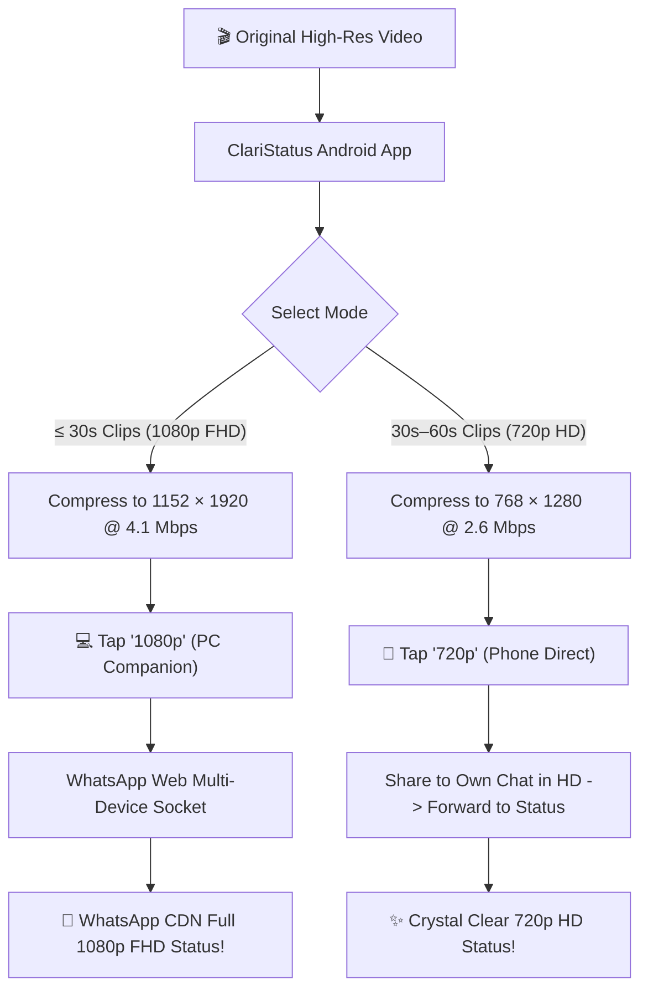

# ClariStatus 🎬✨

[](https://www.gnu.org/licenses/gpl-3.0)
[](https://developer.android.com)
[](https://kotlinlang.org)
[](https://github.com/WhiskeySockets/Baileys)

**ClariStatus** is a 100% free, private, and open-source video compressor and WhatsApp Status optimizer for Android. It bypasses WhatsApp's aggressive status degradation, delivering pristine **1080p Full HD (1152 × 1920 @ 4.1 Mbps)** and **720p HD (768 × 1280 @ 2.6 Mbps)** status videos with **zero ads, zero subscriptions, zero coin paywalls, and zero external cloud servers**.


## 🔍 The Problem with WhatsApp Status

Whenever you upload a video directly through WhatsApp for Android's Status tab:
* WhatsApp forces the video down to **508 × 848 (SD)** at **~1.5 Mbps**, causing severe pixelation, banding, and blurriness.
* Commercial apps (such as PureStatus) charge up to **$10/month** or lock quality behind artificial **coin systems** and intrusive ads.
* **ClariStatus** was created to reverse-engineer and solve this problem once and for all—giving you the exact same high-clarity output for **free, forever**.

---

## 🚀 Two Quality Pathways

ClariStatus provides two distinct workflows tailored to where you are:



### 1. 1080p Full HD (1152 × 1920 @ 4.1 Mbps) — *Via PC Companion*
* **The Secret:** WhatsApp Web / Multi-Device desktop sockets upload directly to WhatsApp's CDN without mobile transcoding filters.
* Compresses using hardware MediaCodec to the exact canvas specifications: **1152 × 1920**, **H.264 High Profile @ Level 4.1**, **1.0s I-Frame interval**, **30 FPS**, and **4.1 Mbps**.
* Uploads through your lightweight local PC companion bot over Wi-Fi in seconds.

### 2. 720p HD (768 × 1280 @ 2.6 Mbps) — *Via Phone Direct (2-Step)*
* **100% On-The-Go:** No computer required.
* Compresses to status-optimized **768 × 1280 @ 2.6 Mbps**.
* Tap **720p** $\rightarrow$ ClariStatus guides you to send to your own chat with WhatsApp's HD toggle enabled $\rightarrow$ forward to **My Status**. WhatsApp preserves the crisp 720p stream without degrading to SD.

---

## ✨ Features

* **💎 Pure Quality**: Outputs up to 1080p FHD (1152 × 1920) matching or beating commercial paid apps.
* **✂️ Auto Story Splitter**: Automatically slices long videos into seamless 30-second or 60-second consecutive story parts with thumbnail previews.
* **⏱️ Precision Video Trimmer**: Interactive visual range slider to select the exact section you want to share.
* **🛡️ 100% Free & Personal**: No coins, no ads, no subscriptions, no tracking, no locked buttons.
* **🔒 100% Private**: Runs completely offline on your device; Wi-Fi transfers are strictly local (LAN).
* **⚡ Hardware Accelerated**: Uses Android's native `MediaCodec` and AndroidX Media3 Transformer for fast transcoding with low battery drain.
* **🎨 Modern UI**: Clean, obsidian dark-themed interface built entirely with Jetpack Compose and Material 3.

---

## 📁 Repository Structure

```text
├── android/                 # Modern Android App (Kotlin + Jetpack Compose)
│   ├── app/src/main/java/
│   │   └── com/claristatus/app/
│   │       ├── data/        # Models & Presets
│   │       ├── domain/      # TargetConfigResolver, VideoSplitter, CompanionClient
│   │       ├── service/     # Foreground Transcoder Service
│   │       ├── ui/          # Compose UI Screens, Dialogs & ViewModel
│   │       └── MainActivity.kt
│   └── build.gradle.kts
│
├── pc-companion/           # Local PC Companion (Node.js + Baileys)
│   ├── server.js            # Express LAN server receiving videos from ClariStatus
│   ├── send-hd.js           # CLI testing utility
│   ├── package.json
│   └── README.md            # Detailed bot setup instructions
├── LICENSE                  # GNU General Public License v3.0 (GPL-3.0)
└── README.md
```

---

## 🛠️ Getting Started

### 1. Build and Install the Android App
Prerequisites: Android Studio or Android SDK with command-line tools.

```bash
# Clone the repository
git clone https://github.com/<your-username>/ClariStatus.git
cd ClariStatus/android

# Build the release APK
./gradlew assembleRelease

# Install on your connected Android device
adb install -r app/build/outputs/apk/release/app-release.apk
```

### 2. Set Up the PC Companion Bot (For 1080p)
Prerequisites: Node.js 18+ on your PC.

```bash
cd pc-companion

# Install dependencies
npm install

# Start the companion service
npm start
```
1. Scan the terminal QR code in WhatsApp (**Linked Devices** $\rightarrow$ **Link a Device**).
2. Note your PC's local IP address (run `ipconfig` on Windows or `ifconfig` on Mac/Linux).
3. In ClariStatus on your phone, after compressing a 30s video, tap **1080p**, enter your PC's IP, and tap **Send to WhatsApp Status**.

*(For detailed instructions, see [`pc-companion/README.md`](pc-companion/README.md))*

---

## 🔬 Reverse-Engineering Specifications

Through binary analysis and empirical benchmarking of WhatsApp Android CDN ingestion, the following parameters were identified as optimal for status uploads:

| Parameter | 1080p FHD (PC Companion) | 720p HD (Phone 2-Step) | Direct WhatsApp Upload (Default) |
| :--- | :--- | :--- | :--- |
| **Resolution** | **1152 × 1920** (Canvas) | **768 × 1280** | 508 × 848 (Forced Downscale) |
| **Video Bitrate** | **4.1 Mbps** (Target 3.9M, Max 4.2M) | **2.6 Mbps** | ~1.5 Mbps |
| **Codec / Profile** | H.264 High Profile @ Level 4.1 | H.264 High Profile | H.264 Baseline / Main |
| **GOP / Keyframe** | **1.0 second** (30 frames) | **1.0 second** | Variable / Inconsistent |
| **Audio** | AAC-LC @ 128 kbps, 44.1 kHz | AAC-LC @ 128 kbps, 44.1 kHz | AAC-LC @ 64–96 kbps |
| **Faststart** | `moov` atom at file beginning | `moov` atom at file beginning | Normal |
| **Result** | **Flawless Full HD** | **Crisp HD** | **Blurry & Pixelated** |

---

## 📜 License

This project is licensed under the **GNU General Public License v3.0 (GPL-3.0)**.

```text
ClariStatus - WhatsApp Status HD & Full HD Video Compressor
Copyright (C) 2026

This program is free software: you can redistribute it and/or modify
it under the terms of the GNU General Public License as published by
the Free Software Foundation, either version 3 of the License, or
(at your option) any later version.
```

Under GPL-3.0, you are free to use, modify, and distribute this software, but commercial entities are strictly prohibited from copying this code into closed-source or paid proprietary applications.
